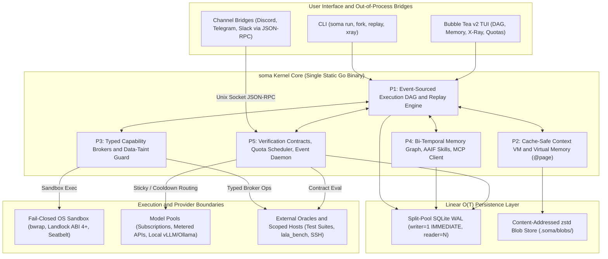

# RFC-0001: `soma` v2.1 — A Durable, Replayable, Capability-Scoped Agent Kernel

| Metadata | Value |
|---|---|
| **Document ID** | RFC-0001 (`soma` v2.1 Architecture & Product Specification) |
| **Status** | Hardened Specification v2.1 (Supersedes v1.0 PDRD & v2.0 Draft) |
| **Target Platforms** | Linux (first-class), macOS (first-class), Windows via WSL2 |
| **Implementation Stack** | Go 1.24+ (Single static binary, zero-CGO core, pure-Go SQLite WAL) |
| **Open Standards** | AAIF Agent Skills (`SKILL.md`), MCP `2026-07-28` (`io.modelcontextprotocol/skills`), Bubble Tea v2 |
| **Competitive Baselines** | Hermes Agent, OpenClaw, Claude Code, Codex CLI |

---

## 1. Executive Summary, Core Thesis & Positioning

### 1.1 The Broken Assumption Behind Current Agent Harnesses

> **Evidence note (Nov 2026).** The Hermes figures in this RFC (rate-limit deaths, orphan reaps, compactions, Curator edits) come from one operator's private 9-day fleet telemetry. The raw logs are not in this repository and the numbers are not reproducible from it, so they are motivation, not measurements. The B1–B6 suites are scripted conformance tests of soma's own mechanisms and do not run Hermes. The competitive table in §1.3 describes Hermes as of the RFC draft; Hermes has since added several of the listed capabilities (for example opt-in checkpoints, container backends and secret stripping). Measured head-to-head results will be published only from `internal/arena`-style runs that execute both agents.
Mainstream AI coding and personal agent harnesses—**OpenClaw**, **Hermes**, **Claude Code**, and **Codex CLI**—all share the same 2024 architectural root: **an agent is a mutable linear chat transcript that directly executes side effects.**

That single abstraction creates the systemic failures observed across production autonomous runs:
1. **Linear Fragility & Crash/429 Loss**: When a rate limit (`HTTP 429`), network timeout, or process reap hits mid-run, linear transcripts either hang, retry blindly into exhaustion, or lose execution state. In 9 days of live Hermes telemetry (multi-host research fleet), **417 / 781 kanban `task_runs` (53.4%)** died `rate_limited` and **739 / 1,662 sessions (44.5%)** ended in `ws_orphan_reap` (including **72.5%** of `ml-arch` sessions dying at 0 tokens).
2. **Raw Log Dumping & Compaction Thrashing**: Injecting raw stdout/stderr directly into the conversation forces lossy LLM summarization loops. Across those 9 Hermes days, **3,458 messages exceeded 16 KiB** (683 over 50 KiB; max 164,660 B), triggering **567 LLM compactions** (peaking at 23 compactions in one `data-lab` session, dropping KV-cache reuse from 94.15% to 81.9%).
3. **Flat-File Memory Rot & Self-Mutation**: Storing facts in flat markdown (`MEMORY.md` saturated at 2,199 / 2,200 B) and append-only logs (`STATUS.md` / `TASKS.md` / `scoreboard.json` ballooned to 833.6 KB) causes stale facts to fight new decisions, while agent self-editing (`150` Curator mutations bloating core skills to ~72 KB) injects harmful defensive rules.
4. **Unconstrained Side Effects & Supply-Chain Exposure**: Broad skill hubs (OpenClaw's ClawHub, "ClawHavoc") and unguarded tool descriptions compromise even frontier models when untrusted observations mix into trusted control flow.
5. **Self-Graded Completion Lies**: Letting the builder model declare victory without external oracle checks produces fabricated completion reports (e.g., Hermes workers claiming `p181` passed while verifier logs described `p183` and `archive.sha256` matched an older build).
6. **Zero Replayability**: Linear mutable logs cannot branch speculatively, fork from step `k`, or replay historical trajectories deterministically under a new prompt or model without re-triggering live side effects.

### 1.2 Core Thesis: Five Orthogonal Kernel Primitives
`soma` v2.0 abandons the linear chat loop and replaces it with a **Durable, Replayable, Capability-Scoped Agent Kernel**—essentially **Temporal + Jujutsu (`jj`) + Capability OS Isolation** purpose-built for LLM tool execution.

Instead of stitching together fragile heuristics, `soma` v2.0 is built from **five minimal, composable primitives**:
1. **Event-Sourced Execution DAG & Deterministic Replay**: Every turn is an immutable content-addressed step in a Merkle DAG, supporting zero-loss crash/429 suspension, speculative hypothesis branching, automatic negative-edge Graveyard capture, and side-effect-free trace replay.
2. **Cache-Safe Hybrid Paged Context VM (`@page`)**: Layers 0 and 1 are frozen per epoch for zero mid-epoch prefix invalidation; large tool outputs spill to content-addressed `@page` blobs with deterministic previews; epoch rollovers preserve compact reasoning/action skeletons while masking old raw observations.
3. **Typed Capability Brokers, Data-Taint Guard & Fail-Closed OS Sandbox**: Compute executes inside an isolated OS sandbox with scrubbed credentials (`bwrap` / Landlock ABI 4+ / Seatbelt). Networked APIs, multi-host SSH commands, and chat channels execute only through host-side typed brokers governed by `deny > ask > allow` and taint provenance tracking.
4. **Bi-Temporal Provenance Memory Graph + Immutable Standards**: Facts and rules live in a bi-temporal SQLite graph (`valid_from`, `valid_to`, M:N `SUPERSEDES`/`MERGES` edges) editable in `$EDITOR`. Skills (`AAIF SKILL.md`) are immutable to the agent and linted before activation; `MCP 2026-07-28` catalogs are epoch-pinned and tainted as untrusted by default.
5. **Pluggable Verification Contracts & Quota-Aware Multi-Account Scheduler**: Tasks close only when external contracts (`command_oracle`, `artifact_oracle`, optional advisory cross-model audit) pass; provider routing handles both flat consumer subscriptions (rolling rate-limit windows, concurrency caps, cooldown persistence) and metered APIs natively, paired with out-of-process Channel Bridges and a Tier-0 event daemon.

### 1.3 Competitive Positioning: `OpenClaw` vs. `Hermes` vs. `soma` v2.0

| Dimension | OpenClaw | Hermes Agent | `soma` v2.0 |
|---|---|---|---|
| **Execution Model** | Linear disk-flushed transcript + gateway router | Linear transcript + cron/kanban profiles (`state.db`) | **Content-addressed Merkle DAG**; durable `SUSPENDED_QUOTA` / `fork` / `replay` |
| **Context & Compaction** | Full transcript + periodic LLM compaction | Threshold LLM summarization (`context_compressor.py`, 567 compactions) | **Cache-safe 4-layer VM** + `@page` observation masking + hybrid skeleton rollover |
| **Memory & Skills** | Instruction files + ClawHub community skills (supply-chain risk) | Flat `MEMORY.md` (2.2 KB cap) + auto-mutating Curator (`72 KB` skill bloat) | **Bi-temporal SQLite graph** (`$EDITOR` native) + immutable linted `AAIF SKILL.md` |
| **Security Boundary** | Gateway auth + sandbox config; broad external skill exposure | Config-level `approvals` regex/guard + shared host env | **Fail-closed OS sandbox** + Typed Capability Brokers + CaMeL taint tracking |
| **General-Use Reach** | 50+ built-in messaging integrations | Discord/Telegram gateway + multi-host terminal | **Thin out-of-process Channel Bridges** (JSON-RPC) + scoped `ssh` / `http` brokers |
| **429 & Crash Handling** | Retries / channel errors | `53.4%` kanban `rate_limited` failures; `44.5%` `ws_orphan_reap` | **Unified metered + subscription quota ledger**; zero-loss suspension & resume |
| **Verification** | Model self-report / user checks | Self-graded `verify-worker-claims` prose + stale artifact leaks | **External `command_oracle` / `artifact_oracle`** + cross-family advisory audit |
| **Observability & Eval** | Granular gateway/session logs | Opaque prompt drops across `state.db` + sticky model fallback lock-in | **3-Boundary X-Ray** (blob-deduped) + deterministic `soma replay` divergence diffs |

### 1.4 v1.0 → v2.0 Architectural Changelog ("What We Cut & Fixed")

| # | v1.0 Spec Defect | Root Failure Analysis | v2.0 Resolution |
|---|---|---|---|
| **1** | **Layer-1 mid-epoch KV-cache bust** (Sec 3.1) | Appending `SUPERSEDES`, Graveyard entries, `SKILL.md` bodies, and MCP schemas to Layer 1 mid-epoch invalidates 100% of Layer 2's prefix cache and triggers `1.25x–2x` cache-write fees. | **Layers 0 and 1 are strictly frozen per epoch.** Mid-epoch loads, rule proposals, and branch failures append strictly to Layer 2's tail and fold into Layer 1 only at Epoch Rollover. |
| **2** | **Zero-LLM Epoch GC amnesia** (Sec 3.4) | Dropping all resolved Layer 2 turns leaving only git commits and `@page` pointers destroys working hypotheses on uncommitted debugging and non-git ML experiments (*The Complexity Trap*, `arXiv:2508.21433`). | **Hybrid observation masking**: Epoch Rollover retains a compact reasoning/action skeleton + pinned invariants + Graveyard while masking verbose raw observations to `@page` handles. |
| **3** | **Secretless Proxy TLS-MITM & Confused Deputy gap** (Sec 7.2) | A Unix-socket proxy cannot inject headers into HTTPS without MITM CA injection across every runtime; stripping keys still permits Confused Deputy exfiltration to allowlisted APIs. | **Host-side Typed Capability Brokers** (`http`, `ssh`, `channel`, `fs`) replace raw HTTPS passthrough; **CaMeL-style data tainting** downgrades write/exfil calls to `ask` after reading untrusted data. |
| **4** | **Basal Ganglia `N=3` compiler & parallel 1-in-25 shadow audits** (Sec 5.1) | Synthesizing brittle `run.sh`/`run.go` programs from 3 traces fails; running a compiled script and an LLM in parallel on side-effecting tasks double-executes mutations or needs unspecified CoW/network mocks. | **Cut completely.** Replaced by deterministic **Event-Sourced Replay** (`soma replay`) and explicit user/skill deterministic commands. |
| **5** | **`+1 / -5` Graduated Trust Ledger deadlock** (Sec 5.3) | Diff-only LLM reviewers exhibit 15%–40% false-positive rates (`p`). Expected score delta for a clean PR is $E[\Delta \text{score}] = 1 - 6p$, which is ≤ 0 for any `p` ≥ 16.7%, mathematically locking out autonomy. | **Cut completely.** Replaced by deterministic `deny > ask > allow` capability policy, taint-gated elevation, and hard Verification Contracts. |
| **6** | **Quadratic `O(T^2)` SQLite bloat, lock contention & schema mismatches** (Sec 9) | Storing full `compiled_frame_json` on every turn balloons SQLite to ~4.5 GB at 9-day scale; single pool hits `SQLITE_BUSY`; single-FK `rules` cannot represent N-to-1 merges; `trigger_runs` PK lacks keys for `sentinel`/`watch`. | **Content-addressed zstd blob store** + `O(T)` step deltas; split `writerDB` (`SetMaxOpenConns(1)` + `BEGIN IMMEDIATE`) / `readerDB`; bi-temporal `memory_nodes` + M:N `memory_edges`; unified `idempotency_key` + `expires_at` GC. |
| **7** | **Single-repo git / unit-test / metered-API blinders** (Sec 4, 7, 8, 10) | `--unshare-net` + hidden `~/.ssh` breaks multi-host ops; `git diff` / read-only unit tests break non-git ML R&D; `$1.50/day` + 50%-off Batch API ignores flat consumer subscriptions; `4m` watch comment contradicted isolated frames. | Workspace-agnostic Layer 3; scoped `ssh` broker; pluggable `command_oracle`/`artifact_oracle`; **unified metered + subscription Quota Scheduler**; explicit `session_mode` on triggers; out-of-process **Channel Bridges**. |

### 1.4.1 v2.0 → v2.1 Review Hardening (5 Critical & High Fixes)

| Severity | v2.0 Gap | v2.1 Fix |
|---|---|---|
| **Critical** | Storing a full compressed prompt blob per turn (`compiled_blob_hash`) only deduplicates exact byte matches, leaving shared L0–L2 prefixes at quadratic `O(T^2)` total storage across turns. | **`epoch_snapshots` + per-turn incremental `frame_delta_blob_hash` + `compiled_frame_hash`**: Layer 0/1 snapshots store once per epoch; turns serialize only new Layer-2 deltas and ephemeral Layer-3 tail, with deterministic `ReconstructFrame` bit-for-bit SHA-256 verification. |
| **Critical** | Crash recovery after remote dispatch before result persistence cannot safely determine whether an external side effect happened. | **2-Phase Durable Action Journal (`action_journal`)**: Tracks `prepared -> dispatched -> recorded | ambiguous | reconciled | aborted` with `effect_class` (`read_only`, `idempotent_write`, `irreversible_write`) and deterministic `idempotency_key`. Uncertain `irreversible_write` actions **never auto-retry**—they suspend to `SUSPENDED_RECONCILE` until reconciled. |
| **High** | Cross-model replay breaks once an alternative model emits a different tool call whose observation was never recorded. | **Three Explicit Replay Modes**: `exact` (offline frame reconstruction + SHA-256 verification), `counterfactual` (alternative model/prompt on recorded `@page` observations strictly until first `(tool_name, args_hash)` divergence), and `sandbox_branch` (forks isolated workspace + live execution). |
| **High** | Logically independent DAG branches writing to the same workspace or remote paths corrupt each other's files. | **Per-Branch Isolated Workspaces & Remote State Leases**: `git_worktree` for clean git repos, `copy_snapshot` + isolated `artifacts/` dirs for dirty/non-git workspaces, plus `remote_leases` + `<run_id>/<branch_id>` path namespacing. |
| **High** | Branch-wide `TAINTED` flags lock down autonomous agents permanently after reading one web page or external log. | **Data/Action-Level Provenance & Scoped Declassification**: Tracks `input_provenance_json` per `@page`/action; keeps isolated workspace read/write autonomous; checks provenance only on external writes; supports deterministic `schema_parser` and scoped `(page_id, capability_scope)` operator declassification while keeping `irreversible_write` gated. |

### 1.5 Non-Goals (v2.1)
- Multi-tenant cloud SaaS orchestration or browser-hosted IDE.
- Native Windows kernel sandboxing (Linux and macOS ship natively; Windows runs via WSL2).
- Baking 50 messaging SDKs into the kernel binary (channels are out-of-process adapters speaking a tiny JSON-RPC contract).
- Self-modifying autonomous prompt/skill loops without human or deterministic oracle gates.

---

## 2. System Topology, Tech Stack & Repository Layout

### 2.1 High-Level Kernel Architecture



### 2.2 Core Tech Stack & Verified Dependencies
- **Language**: Go 1.24+ (static binary, `<50 ms` startup, zero Node/Python runtime dependencies).
- **Terminal UI**: `charm.land/bubbletea/v2` + Lip Gloss v2 + Bubbles v2 (Elm Architecture with cell-based Cursed Renderer).
- **Database**: `modernc.org/sqlite` (pure-Go CGO-free SQLite with split reader/writer pools and WAL mode).
- **Compression & Hashing**: `github.com/klauspost/compress/zstd` + `crypto/sha256` for content-addressed `@page`, step, and frame blobs.
- **CLI, Config & Watchers**: `github.com/spf13/cobra`, `gopkg.in/yaml.v3`, `github.com/fsnotify/fsnotify`.
- **Protocol SDK**: Official `github.com/modelcontextprotocol/go-sdk` targeting **MCP `2026-07-28`** stateless HTTP/header routing and `io.modelcontextprotocol/skills`.

### 2.3 Repository Structure

```text
soma/
├── cmd/
│   ├── soma/main.go                 # Single kernel + CLI + TUI + daemon entrypoint
│   └── soma-bridge-discord/         # Reference out-of-process Channel Bridge
├── internal/
│   ├── config/                      # Global & project config + Hermes/OpenClaw importer
│   ├── store/                       # Split-pool SQLite WAL, migrations.sql, blob store
│   ├── dag/                         # Merkle execution DAG, state machine, branch/fork
│   ├── replay/                      # Deterministic trace replayer & divergence diffing
│   ├── vmem/                        # @page spill store, structural previewers, slice/grep
│   ├── compiler/                    # Cache-safe L0-L3 frame compiler & hybrid rollover
│   ├── sandbox/                     # bwrap, Landlock ABI 4-6 probe, Seatbelt backend
│   ├── broker/                      # Host-side typed brokers (http, ssh, channel, fs)
│   ├── taint/                       # Provenance trust_tier tracking & auto-escalation
│   ├── policy/                      # Deterministic deny > ask > allow evaluator
│   ├── memory/                      # Bi-temporal graph, M:N edges, auditable consolidation
│   ├── skills/                      # AAIF SKILL.md 3-stage loader & security linter
│   ├── mcp/                         # MCP 2026-07-28 client, tool_search, epoch pinning
│   ├── oracle/                      # command_oracle, artifact_oracle, advisory_audit
│   ├── scheduler/                   # Subscription + metered quota ledger, 429 cooldowns
│   ├── triggers/                    # Tier-0 fsnotify/webhook/sentinel daemon & coalescer
│   ├── bridge/                      # Unix-socket JSON-RPC channel bridge protocol
│   ├── tui/                         # Bubble Tea v2 4-tab UI
│   └── cli/                         # Cobra command wiring
└── benchmarks/                      # Reproducible B1-B6 suite vs Hermes & OpenClaw
```

---

## 3. Primitive 1: Event-Sourced Execution DAG, Branching & Deterministic Replay

### 3.1 Immutable Merkle Step Model & True `O(T)` Incremental Frame Deltas
Instead of mutating a JSON chat list in place—or storing redundant full-prompt blobs on every turn (which grows as `O(T^2)` because each turn includes all preceding Layer-2 history)—`soma` stores **one `epoch_snapshots` record per epoch** (holding deduped `layer0_blob_hash` and `layer1_blob_hash`) plus **incremental per-turn `FrameDelta` blobs** (`frame_delta_blob_hash`) containing only the turn's newly appended Layer-2 entries and ephemeral Layer-3 tail, paired with `compiled_frame_hash` (the SHA-256 of the exact wire bytes sent to the model):

```text
step_id = sha256(
    parent_step_id ||
    branch_id ||
    epoch_snapshot_id ||
    model_id ||
    frame_delta_blob_hash ||
    compiled_frame_hash ||
    emitted_blob_hash ||
    observation_page_id
)
```

Exact wire payloads for any historical turn are deterministically rebuilt on demand via `ReconstructFrame(step_id)` by applying the epoch's incremental `frame_delta_blob_hash` chain atop its `epoch_snapshot_id` and verifying `sha256(wire_bytes) == compiled_frame_hash`. Storage scales strictly linearly (`O(T)`) with turn count.

### 3.2 Run Lifecycle, Durable Action Journal & Crash Reconciliation
Every branch in a run obeys an explicit durable state machine persisted via `BEGIN IMMEDIATE` before and after external I/O:

```text
QUEUED ─► RUNNING ─┬─► SUSPENDED_QUOTA      (HTTP 429 / window exhausted; auto-resumes on cooldown expiry)
                   ├─► SUSPENDED_APPROVAL   (policy ask / provenance gate; awaits TUI or Channel Bridge ack)
                   ├─► SUSPENDED_RECONCILE  (crash during uncertain irreversible_write; awaits soma reconcile)
                   ├─► SUSPENDED_IO         (long-running detached SSH/GPU task polling via sentinel)
                   └─► VERIFYING            (running attached Verification Contract)
                          │
                          ├── pass ──► COMPLETED
                          ├── fail ──► RUNNING (counterexample injected into L3) or FORKED
                          └── abort ─► ABANDONED (emits structured Negative Edge into Graveyard)
```

To guarantee **crash safety without unsafe duplicate execution**, every tool/broker invocation is logged in **`action_journal`** with an `action_id`, canonical `idempotency_key`, `effect_class` (`read_only` | `idempotent_write` | `irreversible_write`), and explicit lifecycle state:

```text
prepared ─► dispatched ─┬─► recorded   (atomic TX with steps insert + branch head update)
                        ├─► ambiguous  (crashed while irreversible_write was in-flight)
                        ├─► reconciled (resolved via ActionReconciler or soma reconcile)
                        └─► aborted
```

On restart (`soma resume`), recovery checks any unfinished `action_journal` rows on the branch:
- `prepared`: safe to discard or re-prepare (never dispatched).
- `dispatched` + `read_only`: safe to re-execute automatically.
- `dispatched` + `idempotent_write`: probes `ActionReconciler` if available, else re-dispatches with the **exact persisted `idempotency_key`**.
- `dispatched` + `irreversible_write`: probes deterministic `ActionReconciler` if implemented; if outcome remains uncertain (or no reconciler exists), marks the action `ambiguous`, creates an urgent `inbox_items` entry, transitions the branch to `SUSPENDED_RECONCILE`, and **never auto-retries**.

### 3.3 Speculative Branching, Isolated Workspaces & Graveyard Capture
Following *AIDE* (Jiang et al., 2025), competing branches must never corrupt one another's working files or remote state:
- **Per-Branch Isolated Workspaces (`internal/workspace`)**:
  - Clean Git repositories use `git worktree add --detach .soma/workspaces/<branch_id> HEAD` (`workspace_strategy: git_worktree`).
  - Dirty Git repositories and non-Git ML/ops directories use an isolated copy-snapshot (`.soma/workspaces/<branch_id>/`, excluding `.git/` and `.soma/`) with a dedicated `artifacts/` directory (`workspace_strategy: copy_snapshot`).
- **Remote State Leases (`remote_leases`)**: Remote operations targeting shared external hosts or storage require an active branch lease on `resource_key` and write inside namespaced remote paths (`runs/<run_id>/<branch_id>/`).
- **Automatic Graveyard Generation**: When a branch transitions to `ABANDONED`, the kernel writes a structured `memory_node` of `kind = 'negative_path'` linked to `(signature_hash, attempted_approach, failure_reason, evidence_page_id)` so future epochs and sibling branches never repeat dead ends.

### 3.4 Three Explicit Replay Modes (`soma replay`)
Because an alternative model can diverge onto an unrecorded action whose real-world observation does not exist in history, `soma replay` splits replay into three unambiguous modes:
1. **`exact`** (`--mode exact`): Zero LLM or tool calls. Reconstructs every frame in the ancestry via `ReconstructFrame`, checks bit-for-bit `compiled_frame_hash` integrity, and verifies recorded token/cost accounting.
2. **`counterfactual`** (`--mode counterfactual`): Runs an alternative model or prompt on each reconstructed frame, serving recorded `@page` observations **strictly while the emitted `(tool_name, args_hash)` matches the original step**. The instant a step diverges, replay halts cleanly and reports the exact divergence diff (`DivergedAtStep`, `OriginalAction`, `CounterfactualAction`)—never feeding stale observations to an incompatible action.
3. **`sandbox_branch`** (`--mode sandbox_branch`): Forks a new branch from `--from-step`, provisions an isolated branch workspace, and live-executes the alternative model and tools inside the sandboxed branch to obtain true end-to-end comparative outcomes.

### 3.5 Core Go Interfaces

```go
package dag

import "context"

type BranchStatus string

const (
	StatusQueued             BranchStatus = "queued"
	StatusRunning            BranchStatus = "running"
	StatusSuspendedQuota     BranchStatus = "suspended_quota"
	StatusSuspendedApproval  BranchStatus = "suspended_approval"
	StatusSuspendedReconcile BranchStatus = "suspended_reconcile"
	StatusSuspendedIO        BranchStatus = "suspended_io"
	StatusVerifying          BranchStatus = "verifying"
	StatusCompleted          BranchStatus = "completed"
	StatusFailed             BranchStatus = "failed"
	StatusAbandoned          BranchStatus = "abandoned"
)

type Step struct {
	ID                  string
	RunID               string
	BranchID            string
	ParentStepID        string
	Epoch               int
	TurnIndex           int
	ModelID             string
	StateHash           string
	EpochSnapshotID     string // Frozen Layer 0/1 snapshot (stored once per epoch)
	FrameDeltaBlobHash  string // Incremental Layer-2 delta + Layer-3 tail (zstd blob)
	CompiledFrameHash   string // SHA-256 of exact reconstructed wire bytes
	EmittedBlobHash     string // zstd blob of model response + syscalls
	ObservationPageID   string // @page ID produced by syscall, if any
	InputProvenanceJSON string // Exact @page IDs read by this step's action
}

type StepStore interface {
	AppendStep(ctx context.Context, step Step, upd BranchUpdate) error
	GetAncestry(ctx context.Context, headStepID string) ([]Step, error)
}
```

---

## 4. Primitive 2: Cache-Safe Hybrid Paged Context VM (`@page`)

### 4.1 The Strict Prefix-Stability Law (Fixing v1.0's Cache Bug)
Prompt KV caches across Anthropic (`0.1x` / `0.025x` cache reads vs. `1.25x`–`2x` cache writes), OpenAI (`prompt_cache_breakpoint`), and local vLLM/SGLang RadixAttention require **byte-for-byte prefix identity from token 0**. Mutating Layer 1 mid-epoch—as `soma` v1.0 specified—destroys the cache for all of Layer 2.

`soma` v2.0 enforces **strict epoch immutability on Layers 0 and 1**:

```text
┌───────────────────────────────────────────────────────────────────────────┐
│ LAYER 0: FROZEN SYSTEM & TOOL PREFIX (Immutable for Entire Epoch)         │
│ • Kernel instructions & workspace mode header                             │
│ • Alphabetically sorted core syscalls (fs_read, fs_patch, exec,           │
│   broker_call, page_slice, page_grep, tool_search, branch_fork)           │
│ • AAIF skill frontmatter index (~100 tok/skill, sorted by name)           │
│ • Epoch-pinned sorted MCP server 1-line summaries                         │
│ • Pinned Task Goal & Verification Contract specification                  │
├══════════════ CACHE BREAKPOINT 1 (Longest TTL: e.g. 1h on Anthropic) ═════┤
│ LAYER 1: FROZEN EPOCH REGISTERS (Snapshot at Epoch Start — Zero Mutations)│
│ • Active scoped memory_nodes ([M-0014], sorted deterministically)         │
│ • Active Graveyard negative_path entries from prior branches/epochs       │
│ • Pre-activated AAIF SKILL.md bodies & MCP schemas carried from epoch N-1 │
├══════════════ CACHE BREAKPOINT 2 (Stable Mid-Epoch Anchor) ═══════════════┤
│ LAYER 2: STRICTLY APPEND-ONLY WORKING LOG (+~350 tok/turn)                │
│ • Compact turn trace: reasoning summary + syscall + 60-tok @page preview  │
│ • On-demand page_slice / page_grep returns                                │
│ • MID-EPOCH DYNAMIC LOADS (appended at tail ONLY — never in Layer 1!):    │
│   - Newly matched SKILL.md bodies                                         │
│   - Newly discovered MCP tool JSON schemas via tool_search                │
│   - Newly created proposed rules / newly failed sibling branch notices    │
├══════════════ CACHE BREAKPOINT 3 (Rolling Tail — 5m / Session Refresh) ═══┤
│ LAYER 3: EPHEMERAL LIVE TAIL (~1.2k tok — Uncached, Rebuilt Every Turn)   │
│ • Workspace-aware state: git diff --stat (if git) OR recent artifacts,    │
│   active lockfiles, & detached remote job status (if non-git R&D/ops)     │
│ • Latest Verification Contract failure / counterexample output            │
│ • Remaining step budget, account quota status, and stall-detector count   │
└───────────────────────────────────────────────────────────────────────────┘
```

### 4.2 `@page` Virtual Memory & Anti-Syscall-Tax Thresholds
Drawing on *The Complexity Trap* (Lindenbauer et al., NeurIPS DL4C 2025, `arXiv:2508.21433`)—which established that verbose environment observations represent ~84% of agent trajectory tokens and deterministic observation masking halves cost while matching or beating LLM summarization—alongside *Lost in the Middle* (Liu et al., TACL 2024) and *Context Rot* (Chroma Research, 2025):
- **Thresholded Paging**: Outputs below the active model profile's inline threshold (`3 KiB` for 14B–32B workers; `16 KiB` for frontier models) enter Layer 2 directly, eliminating *MemGPT*-style extra round-trips on small file reads.
- **Content-Addressed Spill + Type-Aware Previewers**: Any observation exceeding the threshold spills to `.soma/blobs/` (registered in `pages`), and injects only a ~60-token manifest + 10–15 line deterministic structural preview:
  - `log` / `test`: exit code, pass/fail summary, top failing assertion/traceback lines, byte/line counts.
  - `code`: language, LOC, exported symbols/functions with line ranges.
  - `json` / `yaml`: top-level keys, array counts, schema skeleton, first sample record.
  - `tabular` (`.csv` / `.parquet` via pure-Go parquet reader or metadata summary): row count, column names/dtypes, null counts, top 3 rows.
  - `diff`: per-file `+`/`-` hunks and line numbers.
- **Targeted Inspection**: The model inspects spilled data via `page_slice(page_id, start_line, end_line)` or `page_grep(page_id, regex)`.

### 4.3 Hybrid Epoch Rollover (Zero-Amnesia Context Maintenance)
When Layer 2 crosses the active model profile's ceiling (`20k` tokens for local/small workers; `80k–120k` for frontier models, well below the `272k` long-context pricing cliff), `soma` executes a **Hybrid Epoch Rollover**:
1. **Promote & Fold**: Any mid-epoch `SKILL.md` bodies, MCP schemas, and committed `memory_nodes` / Graveyard entries appended to Layer 2 are folded cleanly into the next epoch's **Layer 1 snapshot**.
2. **Observation Masking + Skeleton Preservation**: Active-branch reasoning steps and tool-call intentions are kept in compact action-skeleton form (not deleted!), while older raw tool outputs and `page_slice` bodies are replaced with 1-line `@page_id` pointers.
3. **Optional Branch Summarization**: Only *closed/completed* sub-tasks exceeding the skeleton budget are compressed—never discarding active hypotheses or failed Graveyard paths.

### 4.4 Provider-Specific Cache Mechanics
- **Anthropic (e.g., Fable 5.2)**: Longest-TTL breakpoints first (`1h` at Breakpoint 1 for daemon/long tasks; `5m` rolling refresh at Breakpoints 2–3 for interactive turns). Enforces model minimum prefix thresholds (`512–4,096` tokens).
- **OpenAI (e.g., GPT-6.2 Astra / Sol)**: Uses `prompt_cache_options` and deterministic key/tool ordering; dynamically enables/disables callable tools via `allowed_tools` without mutating Layer 0 schemas; tunes reasoning effort via `configuration_update` without cache busting.
- **Local Engines (vLLM / SGLang / llama.cpp)**: Maximizes RadixAttention hit rates by pinning token-0 prefixes and bounding frame ceilings tightly to protect GPU VRAM.

---

## 5. Primitive 3: Typed Capability Brokers, Data-Taint Guard & OS Sandboxing

### 5.1 Fail-Closed OS Compute Sandbox
Regex blocklists over shell strings fail trivially. Local process execution runs inside an OS-enforced sandbox controlled by a clean `SandboxBackend` Go interface, with `sandbox.fail_if_unavailable: true` by default:
- **Linux Primary (`bubblewrap`)**: Minimal unprivileged mount namespace exposing only the explicitly mounted workspace (`rw`), minimal immutable system binaries (`ro`), and ephemeral `/tmp`. Host `~/.ssh`, `~/.aws`, `~/.gnupg`, and unrelated home directories do not exist in the mount tree. Network namespace is unshared (`--unshare-net`) by default.
- **Linux Fallback (Landlock LSM + seccomp-BPF)**: At startup, `soma` probes the kernel's maximum supported ABI via `landlock_create_ruleset(NULL, 0, LANDLOCK_CREATE_RULESET_VERSION)`:
  - When network isolation is required, **ABI ≥ 4** (`LANDLOCK_ACCESS_NET_BIND_TCP`, `LANDLOCK_ACCESS_NET_CONNECT_TCP`) is mandatory; falling back on ABI ≤ 3 fails closed instead of silently allowing raw outbound sockets.
  - Opportunistically enables **ABI 5** (`LANDLOCK_ACCESS_FS_IOCTL_DEV`) and **ABI 6** (`LANDLOCK_SCOPE_ABSTRACT_UNIX_SOCKET`, `LANDLOCK_SCOPE_SIGNAL`) to block abstract-socket and signal escapes.
- **macOS (`Seatbelt` via `sandbox-exec`)**: Dynamically generated SBPL profile denying reads to credential paths, restricting writes to the active workspace, and blocking raw network sockets. *(Because Apple officially deprecated `sandbox-exec`, macOS isolation sits behind `SandboxBackend` so future Virtualization.framework/container backends swap in cleanly.)*

### 5.2 Host-Side Typed Capability Brokers (Replacing v1.0's Broken HTTPS Proxy)
To support general-purpose automation—multi-host SSH/GPU clusters, GitHub/API integrations, and messaging bridges—without punching holes in the sandbox or resorting to fragile TLS MITM certificates across Python/Node/Go runtimes, sandboxed processes hold **zero raw credentials** and invoke host-side capabilities over a Unix domain socket via `broker_call(capability, op, params)`:

| Broker | Scope & Enforced Schema | Example General-Use Workflow |
|---|---|---|
| **`http`** | Allowlisted domain + path regex + HTTP method + JSON field constraints; host injects auth header directly into its own outbound HTTPS client (zero CA/MITM injection inside sandbox). | Create GitHub Draft PR (`draft: true` enforced), query RunPod API, fetch Hugging Face model cards. |
| **`ssh`** | Allowlisted host alias (`vm-lab-01`, `gpu-node-01`) + parameterized command templates / prefix allowlists + remote path scoping; host executes via host-managed SSH agent (`ControlMaster` / key). | Launch training on `gpu-node-01`, check `virsh` / `nvidia-smi`, `rsync` bounded export directories—**without ever mounting `~/.ssh` into the sandbox**. |
| **`fs`** | Explicit policy-gated access to declared external read-only datasets or output directories outside the primary workspace. | Read `/data/eval_freeze_v1` (`ro`) while preventing writes to frozen benchmarks. |
| **`channel`** | Route outbound drafts, status cards, and approval prompts to configured out-of-process Channel Bridges. | Post verification summaries to Discord/Telegram without holding bot tokens inside compute. |

### 5.3 Data/Action-Level Provenance & Scoped Declassification
Grounded in *CaMeL* (Debenedetti et al., `arXiv:2503.18813`, IEEE SaTML 2026) and *MCPTox* (Wang et al., `arXiv:2508.14925`), preventing **Confused Deputy** exfiltration cannot rely on a blunt branch-wide taint flag that permanently locks down a research agent after reading one web page. Instead, `soma` tracks provenance at the **data and action level**:
1. **Per-Page `trust_tier` (`TRUSTED_USER | TRUSTED_REPO | UNTRUSTED_EXTERNAL`)**: Recorded on every `@page` and referenced explicitly in `action_journal.input_provenance_json`.
2. **Action Effect Classes (`read_only | workspace_write | external_write | irreversible_write`)**:
   - **`read_only` & isolated `workspace_write`**: Remain `allow` inside the branch's isolated sandbox/workspace even after reading `UNTRUSTED_EXTERNAL` pages—so web research, log reading, and local code edits stay autonomous.
   - **`external_write`**: Evaluated strictly against the **exact `ReferencedPageIDs`** consumed by that action. Only if an action references an un-declassified `UNTRUSTED_EXTERNAL` page does policy downgrade `allow` → `ask`.
   - **`irreversible_write`** (e.g., force pushes, deletions, billing actions, non-draft external sends): Always governed by `deny`/`ask` policy regardless of taint or declassification.
3. **Two Scoped Declassification Paths (`declassifications` table)**:
   - **`schema_parser` (Deterministic Non-LLM Sanitization)**: Running a strict schema/numeric/checksum parser (e.g., `DeclassifyStructured[T]`) over an untrusted `@page` strips arbitrary prose and records a typed declassification for a single `capability_scope`.
   - **`operator_approval`**: Human review explicitly declassifies a specific `(page_id, capability_scope)` tuple without tainting or unblocking unrelated capabilities.

### 5.4 Out-of-Process Channel Adapter Protocol (Competing with OpenClaw & Hermes)
Rather than embedding dozens of brittle chat SDKs into the kernel binary, `soma` defines a minimal **4-message JSON-RPC 2.0 protocol** over a local Unix socket (`~/.soma/bridges/<name>.sock`):
- `channel.inbound`: External bridge delivers `{bridge_id, channel_id, sender_id, is_authorized_operator, thread_id, text, attachments[]}` → kernel routes to an isolated session or wakes a branch.
- `channel.outbound`: Kernel requests posting `{channel_id, thread_id, markdown, attachments[]}` (respecting `capability: notify_only | draft_only`).
- `channel.approval_card`: Kernel sends interactive `{branch_id, capability, summary, payload_preview, approve_token}` when hitting `SUSPENDED_APPROVAL`.
- `channel.approval_reply`: Operator clicks Approve/Deny in Discord/Telegram/Slack → bridge signs and returns `{approve_token, decision, operator_id}` → kernel resumes the suspended DAG branch.

---

## 6. Primitive 4: Bi-Temporal Provenance Memory Graph, AAIF Skills & MCP `2026-07-28`

### 6.1 Bi-Temporal Provenance Memory Graph
Grounded in *Zep* (Rasmussen et al., Jan 2025, `arXiv:2501.13956`), `soma` replaces flat append-only markdown and broken age-based decay with a typed **Bi-Temporal Memory Graph** stored in `memory_nodes` and `memory_edges`:
- **Bi-Temporal Coordinates**: Every rule, architectural fact, or user preference records both **fact validity** (`valid_from`, `valid_to`) and **system provenance** (`ingested_at`, `provenance_step_id`, `trust_tier`).
- **M:N Evolution Edges**: `memory_edges` links nodes via `SUPERSEDES`, `MERGES`, `CONTRADICTS`, and `DERIVED_FROM`, supporting both 1-to-1 updates and N-to-1 rule consolidation cleanly.
- **Zero Lock-In `$EDITOR` Ownership**: Tab 2 in the TUI and `soma memory edit` open rules directly as clean YAML/Markdown projections over SQLite—no begging a chatbot to rewrite `MEMORY.md`.

### 6.2 Anti-Poisoning Guards (*MINJA*) & Auditable Consolidation
*MINJA* (Dong et al., Mar 2025, `arXiv:2503.03704`) proves attackers can poison persistent agent memory solely through normal external observations. Therefore:
- **Untrusted Writes Never Auto-Activate**: Observations tagged `UNTRUSTED_EXTERNAL` can only emit `status = 'proposed'` nodes, never `status = 'active'` system instructions.
- **Model-Agnostic Offline Consolidation (`soma consolidate`)**: Runs on demand, on idle windows, or on schedule using **any configured backend** (local GPU model, metered Batch API, or off-peak subscription capacity—never assuming a 50%-off Batch API exists). Consolidation:
  1. Audits existing `active` facts against current workspace ground truth (verifying referenced file paths, symbols, host aliases, and config keys still exist).
  2. Proposes M:N `MERGES` or `SUPERSEDES` edges for contradicting entries.
  3. Stages proposals in the Inbox (`status = 'proposed'`) for one-keystroke `[a] Approve` / `[e] Edit` / `[d] Dismiss` unless scoped auto-pruning of dead file paths is explicitly permitted.

### 6.3 Immutable AAIF `SKILL.md` & Pre-Activation Security Linter
- **Strict AAIF Specification Compliance**: `<skill-name>/SKILL.md` (1–64 char lowercase hyphenated `name` matching directory, 1–1,024 char `description`, optional `scripts/`, `references/`, `assets/`).
- **Zero Self-Mutating Skill Bloat**: Agents are strictly forbidden from mutating active skill directories directly (eliminating Hermes's 150-edit Curator runaway). Proposed skill improvements emit patch files into `inbox_items` for operator approval.
- **Pre-Activation Security Linter (`internal/skills/lint.go`)**: Inspects `SKILL.md` and `scripts/` via AST/pattern scanning before activation for prompt-injection overrides, hidden Unicode control characters, credential-env sweeps, `curl | sh` pipes, and undeclared network calls—quarantining unverified community skills as `UNTRUSTED_EXTERNAL`.

### 6.4 MCP `2026-07-28` Stateless Client
Implemented on top of the official `github.com/modelcontextprotocol/go-sdk`:
- **Stateless Header Routing**: Speaks `MCP-Protocol-Version: 2026-07-28`, propagating `Mcp-Method` and `Mcp-Name` headers, cacheable tool listings, optional modular Tasks handles, and `io.modelcontextprotocol/skills` (`skills/list`, `skills/get`).
- **Epoch-Pinned Sorted Catalogs + Deferred `tool_search`**: Server tool metadata is snapshotted and sorted lexicographically at epoch start; full schemas load only into **Layer 2's tail** via `tool_search(query)` so reconnects or tool discovery never bust Layer 0/1 KV caches.
- **Untrusted Metadata Policy**: Third-party MCP server descriptions and annotations are tagged `UNTRUSTED_EXTERNAL` (*MCPTox* defense) and never bypass the Policy Engine.

---

## 7. Primitive 5: Verification Contracts, Quota-Aware Scheduler & Event Daemon

### 7.1 Generalized External Verification Contracts
Grounded in *Huang et al.* (ICLR 2024), *Panickssery et al.* (NeurIPS 2024), *ImpossibleBench* (`arXiv:2510.20270`), and *Baker et al.* (OpenAI, 2025), a branch cannot transition to `COMPLETED` on agent prose alone. Each task binds one or more pluggable contracts (`contracts` table):
1. **`command_oracle`**: Executes deterministic external verification commands (unit/integration suites, linters, or frozen ML benchmarks like `lala_bench` across multi-track stress/causality gates). Crucially separates **`pinned_invariants`** (mounted read-only / hash-locked, e.g., held-out eval suites or regression assertions) from **`mutable_dev_tests`** (allowing legitimate code refactors without breaking developer workflow).
2. **`artifact_oracle`**: Verifies existence, JSON/Parquet schema validity, non-null metric keys, and **`sha256` freshness** (explicitly rejecting stale hashes copied from prior runs).
3. **`advisory_audit`**: Optional zero-history cross-vendor model review receiving only `(task_contract, graveyard_summary, git_diff_or_artifact_manifest)`. Findings inject concrete counterexamples into Layer 3 for the builder to address—**advisory only**, with zero mathematical vote-penalty coupling.

### 7.2 Unified Metered + Subscription Quota Scheduler
To survive both metered API keys and consumer flat-rate subscriptions (`openai-codex`, `xai-oauth`, `opencode-go`, `qwencloud-token-plan`) without Hermes's 53.4% `rate_limited` crash rate:

```yaml
accounts:
  - id: codex-plus
    provider: openai-codex
    model: gpt-6.2-sol
    billing_mode: subscription        # metered | subscription
    max_concurrent: 1
    window_limits:
      requests_per_5h: 80
    cooldown_on_429: parse_retry_after # fallback 15m exponential

  - id: xai-premium
    provider: xai-oauth
    model: grok-4.6
    billing_mode: subscription
    max_concurrent: 2

  - id: local-worker
    provider: openai-compat
    base_url: http://127.0.0.1:11434/v1
    model: qwen3.8-14b
    billing_mode: local
    max_concurrent: 1

  - id: anthropic-api
    provider: anthropic
    model: claude-fable-5.2
    billing_mode: metered
    daily_budget_usd: 5.00
```

- **Sticky-Epoch Routing**: Within a running epoch, `soma` pins the active `(account_id, model_id)` so soft latency jitter never invalidates KV cache. If a hard `429` hits, the scheduler persists `cooldown_until` in SQLite `accounts`, transitions the branch cleanly to `SUSPENDED_QUOTA`, and either resumes once the window resets or—if configured for failover—starts a **clean new epoch** on a fallback account using a compact **Handoff Packet** (`task_contract + Graveyard + branch diff/artifacts + @page handles`), **never** permanently locking the interactive session onto a degraded fallback model.
- **Progress-Stall Breaker & Escalation**: Drawing on *RouteLLM* (`arXiv:2406.18665`) and *AutoMix* (NeurIPS 2024), workers track `state_hash` across turns; after `K` zero-progress turns (configurable: 2 on small workers, 4–5 on frontier), the branch pauses or escalates cleanly rather than burning 100/120 loop iterations.

### 7.3 Tier-0 Event Daemon, Coalescer & Inhibitory Brakes
Replaces blind LLM cron polling (`HEARTBEAT_OK`) and unpruned 3.29 MB cron histories with a deterministic event pipeline:
- **Tier-0 Watchers (Zero Tokens)**: `fsnotify` filesystem triggers, localhost HTTP webhook listener, and scheduled shell/SQL probes computing `sha256(stdout)`. Unchanged outputs skip immediately at zero token cost.
- **Coalescer & Mandatory Idempotency + TTL GC**: Every trigger type (`webhook`, `sentinel`, `cron`, `watch`) automatically derives a canonical `idempotency_key` when omitted (e.g., `sha256(trigger_id + time_bucket + payload_hash)`), coalesces bursts within `debounce`, and stores `expires_at` in `trigger_runs` for automatic periodic GC.
- **Hard Inhibitory Brakes**: Deterministic SQLite guards halt non-urgent background runs whenever `pending_inbox_items >= max_pending_inbox` (default `3`), active subscription accounts are in cooldown, metered spend breaches `daily_reserve_floor`, or `quiet_hours` is active.
- **Explicit Session Semantics (`session_mode`)**: Triggers explicitly choose `session_mode: isolated` (fresh frame per fire) or `session_mode: warm_branch` (reuses one persistent branch inside a 4-minute TTL cadence to preserve 5-minute KV cache while active), resolving v1.0's internal contradiction.

```yaml
# ~/.soma/triggers.yaml
version: 2
quiet_hours: "23:00-07:30"
max_pending_inbox: 3
daily_metered_budget_usd: 3.00

triggers:
  - id: ci-failure-triage
    type: webhook
    source: github.workflow_run
    filter: "conclusion == 'failure'"
    debounce: 30s
    idempotency_key: "ci:{{ .repo }}:{{ .head_sha }}"
    session_mode: isolated
    capability: draft_only
    max_turns: 12
    ttl_retention: 14d
    prompt: "Diagnose CI failure logs via @page and stage a draft fix branch."

  - id: remote-lab-export-watch
    type: sentinel
    interval: 15m
    command: "soma broker ssh vm-lab-01 list_exports_hash"
    wake_on: output_hash_changed
    debounce: 60s
    session_mode: isolated
    capability: draft_only
    ttl_retention: 7d
    prompt: "Verify new campaign exports and trigger ingest contract."

  - id: pr-checks-watch
    type: watch
    interval: 4m
    ttl: 45m
    session_mode: warm_branch         # Explicitly reuses one branch to stay warm inside 5m cache TTL
    stop_command: "gh pr checks 42 --json state | jq -e 'all(.state == \"SUCCESS\")'"
    capability: notify_only
```

---

## 8. Complete Data Model & Concurrency Architecture (`internal/store/migrations.sql`)

### 8.1 Split-Pool SQLite + Content-Addressed Blob Strategy
1. **Zero `SQLITE_BUSY` Pool Discipline**: `internal/store` opens **two** `database/sql` handles against `project.db`:
   - `writerDB`: `SetMaxOpenConns(1)`, DSN `?_pragma=journal_mode(WAL)&_pragma=synchronous(NORMAL)&_pragma=foreign_keys(ON)&_pragma=busy_timeout(5000)&_txlock=immediate` — serializing all Go writes cleanly without deferred lock-upgrade deadlocks.
   - `readerDB`: `SetMaxOpenConns(max(4, runtime.NumCPU()))`, DSN `?_pragma=journal_mode(WAL)&_pragma=query_only(ON)&_pragma=busy_timeout(5000)` — allowing concurrent non-blocking TUI, X-Ray, and daemon reads.
2. **True Linear `O(T)` Storage via Incremental Frame Deltas + zstd Blobs**: Epoch Layers 0–1 store once in `epoch_snapshots`; turns store only incremental `FrameDelta` blobs (`frame_delta_blob_hash`) alongside `@page` and emitted payloads under `.soma/blobs/<sha256[:2]>/<sha256>.zst`. SQLite rows stay compact and wire payloads reconstruct bit-for-bit on demand.

### 8.2 Schema Specification (`internal/store/migrations.sql`)

```sql
PRAGMA journal_mode = WAL;
PRAGMA foreign_keys = ON;

-- 1. Top-level Tasks / Runs
CREATE TABLE IF NOT EXISTS runs (
    id TEXT PRIMARY KEY,
    title TEXT NOT NULL,
    workspace_path TEXT NOT NULL,
    workspace_kind TEXT NOT NULL DEFAULT 'generic', -- 'git' | 'research' | 'ops' | 'generic'
    goal_spec TEXT NOT NULL,
    status TEXT NOT NULL DEFAULT 'queued',
    created_at INTEGER NOT NULL,
    updated_at INTEGER NOT NULL
);

-- 2. Speculative / Active Execution Branches (Isolated Workspaces)
CREATE TABLE IF NOT EXISTS branches (
    id TEXT PRIMARY KEY,
    run_id TEXT NOT NULL REFERENCES runs(id) ON DELETE CASCADE,
    parent_branch_id TEXT REFERENCES branches(id),
    forked_from_step_id TEXT,                       -- Nullable for root branch
    label TEXT NOT NULL,
    head_step_id TEXT,                              -- Updated monotonically on step append
    epoch INTEGER NOT NULL DEFAULT 1,
    status TEXT NOT NULL DEFAULT 'queued',
    workspace_dir TEXT NOT NULL DEFAULT '',         -- Isolated git worktree or copy snapshot
    workspace_strategy TEXT NOT NULL DEFAULT 'copy_snapshot', -- 'git_worktree' | 'copy_snapshot' | 'artifact_dir'
    active_account_id TEXT,
    stall_count INTEGER NOT NULL DEFAULT 0,
    created_at INTEGER NOT NULL,
    updated_at INTEGER NOT NULL
);

-- 3. Frozen Epoch Prefix Snapshots (Stored Once Per Epoch)
CREATE TABLE IF NOT EXISTS epoch_snapshots (
    id TEXT PRIMARY KEY,
    run_id TEXT NOT NULL REFERENCES runs(id) ON DELETE CASCADE,
    branch_id TEXT NOT NULL REFERENCES branches(id) ON DELETE CASCADE,
    epoch INTEGER NOT NULL,
    layer0_blob_hash TEXT NOT NULL,
    layer1_blob_hash TEXT NOT NULL,
    prefix_hash_l0_l1 TEXT NOT NULL,
    metadata_json TEXT NOT NULL,
    created_at INTEGER NOT NULL
);

-- 4. Virtual Memory (@page) Index (Blobs stored zstd-compressed on disk)
CREATE TABLE IF NOT EXISTS pages (
    id TEXT PRIMARY KEY,                            -- e.g. 'page_0042'
    run_id TEXT NOT NULL REFERENCES runs(id) ON DELETE CASCADE,
    content_hash TEXT NOT NULL,
    blob_path TEXT NOT NULL,
    content_type TEXT NOT NULL,                     -- 'log' | 'code' | 'json' | 'tabular' | 'diff' | 'http' | 'text'
    trust_tier TEXT NOT NULL DEFAULT 'trusted_repo',-- 'trusted_user' | 'trusted_repo' | 'untrusted_external'
    declassified INTEGER NOT NULL DEFAULT 0,
    declassified_by TEXT,
    byte_size INTEGER NOT NULL,
    line_count INTEGER NOT NULL,
    preview_text TEXT NOT NULL,
    last_accessed_at INTEGER NOT NULL,
    created_at INTEGER NOT NULL
);

-- 5. Immutable Event-Sourced Execution DAG Steps (True O(T) Incremental Deltas)
CREATE TABLE IF NOT EXISTS steps (
    id TEXT PRIMARY KEY,                            -- Content-addressed Merkle SHA-256
    run_id TEXT NOT NULL REFERENCES runs(id) ON DELETE CASCADE,
    branch_id TEXT NOT NULL REFERENCES branches(id) ON DELETE CASCADE,
    parent_step_id TEXT REFERENCES steps(id),
    epoch INTEGER NOT NULL,
    turn_index INTEGER NOT NULL,
    account_id TEXT NOT NULL,
    model_id TEXT NOT NULL,
    state_hash TEXT NOT NULL,
    epoch_snapshot_id TEXT NOT NULL REFERENCES epoch_snapshots(id),
    frame_delta_blob_hash TEXT NOT NULL,            -- Incremental delta blob (zstd)
    compiled_frame_hash TEXT NOT NULL,              -- SHA-256 of exact reconstructed wire bytes
    emitted_blob_hash TEXT NOT NULL,                -- zstd blob of model response + syscalls
    observation_page_id TEXT REFERENCES pages(id),
    input_provenance_json TEXT NOT NULL DEFAULT '[]',
    input_tokens INTEGER NOT NULL DEFAULT 0,
    cache_read_tokens INTEGER NOT NULL DEFAULT 0,
    cache_write_tokens INTEGER NOT NULL DEFAULT 0,
    output_tokens INTEGER NOT NULL DEFAULT 0,
    cost_usd REAL NOT NULL DEFAULT 0.0,
    latency_ms INTEGER NOT NULL DEFAULT 0,
    created_at INTEGER NOT NULL
);

-- 6. 2-Phase Durable Action Journal (Crash Recovery & Idempotency)
CREATE TABLE IF NOT EXISTS action_journal (
    action_id TEXT PRIMARY KEY,
    run_id TEXT NOT NULL REFERENCES runs(id) ON DELETE CASCADE,
    branch_id TEXT NOT NULL REFERENCES branches(id) ON DELETE CASCADE,
    parent_step_id TEXT REFERENCES steps(id),
    epoch INTEGER NOT NULL,
    turn_index INTEGER NOT NULL,
    tool_name TEXT NOT NULL,
    args_json TEXT NOT NULL,
    args_hash TEXT NOT NULL,
    effect_class TEXT NOT NULL,                     -- 'read_only' | 'idempotent_write' | 'irreversible_write'
    idempotency_key TEXT NOT NULL,
    input_provenance_json TEXT NOT NULL DEFAULT '[]',
    status TEXT NOT NULL,                           -- 'prepared' | 'dispatched' | 'recorded' | 'ambiguous' | 'reconciled' | 'aborted'
    result_page_id TEXT REFERENCES pages(id),
    result_summary TEXT,
    error_text TEXT,
    created_at INTEGER NOT NULL,
    updated_at INTEGER NOT NULL
);

-- 7. Scoped Provenance Declassifications & Remote Resource Leases
CREATE TABLE IF NOT EXISTS declassifications (
    id TEXT PRIMARY KEY,
    page_id TEXT NOT NULL REFERENCES pages(id) ON DELETE CASCADE,
    capability_scope TEXT NOT NULL,
    method TEXT NOT NULL,                           -- 'schema_parser' | 'operator_approval'
    approved_by TEXT NOT NULL,
    schema_name TEXT,
    created_at INTEGER NOT NULL
);

CREATE TABLE IF NOT EXISTS remote_leases (
    resource_key TEXT PRIMARY KEY,
    branch_id TEXT NOT NULL REFERENCES branches(id) ON DELETE CASCADE,
    remote_namespace TEXT NOT NULL,
    expires_at INTEGER NOT NULL,
    created_at INTEGER NOT NULL
);

-- 8. Bi-Temporal Provenance Memory Graph & Negative Paths (Graveyard)
CREATE TABLE IF NOT EXISTS memory_nodes (
    id TEXT PRIMARY KEY,                            -- e.g. 'M-0014'
    scope TEXT NOT NULL,                            -- 'global' | 'repo:<id>' | 'glob:<pattern>'
    kind TEXT NOT NULL,                             -- 'rule' | 'fact' | 'preference' | 'negative_path'
    content TEXT NOT NULL,
    signature_hash TEXT,                            -- Normalized failure hash for negative_path dedup
    status TEXT NOT NULL DEFAULT 'active',          -- 'proposed' | 'active' | 'superseded' | 'archived'
    trust_tier TEXT NOT NULL DEFAULT 'trusted_user',-- 'trusted_user' | 'trusted_repo' | 'untrusted_external'
    provenance_step_id TEXT REFERENCES steps(id),
    evidence_page_id TEXT REFERENCES pages(id),
    valid_from INTEGER NOT NULL,
    valid_to INTEGER,                               -- NULL while currently valid
    ingested_at INTEGER NOT NULL,
    enabled INTEGER NOT NULL DEFAULT 1
);

CREATE TABLE IF NOT EXISTS memory_edges (
    id INTEGER PRIMARY KEY AUTOINCREMENT,
    from_node_id TEXT NOT NULL REFERENCES memory_nodes(id) ON DELETE CASCADE,
    to_node_id TEXT NOT NULL REFERENCES memory_nodes(id) ON DELETE CASCADE,
    relation TEXT NOT NULL,                         -- 'SUPERSEDES' | 'MERGES' | 'CONTRADICTS' | 'DERIVED_FROM'
    provenance_step_id TEXT REFERENCES steps(id),
    created_at INTEGER NOT NULL,
    UNIQUE(from_node_id, to_node_id, relation)
);

-- 9. Pluggable External Verification Contracts
CREATE TABLE IF NOT EXISTS contracts (
    id TEXT PRIMARY KEY,
    run_id TEXT NOT NULL REFERENCES runs(id) ON DELETE CASCADE,
    kind TEXT NOT NULL,                             -- 'command_oracle' | 'artifact_oracle' | 'advisory_audit'
    spec_json TEXT NOT NULL,
    pinned_hash TEXT NOT NULL,
    required INTEGER NOT NULL DEFAULT 1,
    created_at INTEGER NOT NULL
);

CREATE TABLE IF NOT EXISTS contract_runs (
    id TEXT PRIMARY KEY,
    contract_id TEXT NOT NULL REFERENCES contracts(id) ON DELETE CASCADE,
    branch_id TEXT NOT NULL REFERENCES branches(id) ON DELETE CASCADE,
    step_id TEXT NOT NULL REFERENCES steps(id) ON DELETE CASCADE,
    passed INTEGER NOT NULL,
    output_page_id TEXT REFERENCES pages(id),
    artifact_sha256 TEXT,
    counterexample_text TEXT,
    duration_ms INTEGER NOT NULL DEFAULT 0,
    created_at INTEGER NOT NULL
);

-- 10. Unified Metered & Subscription Account Quota Ledger
CREATE TABLE IF NOT EXISTS accounts (
    id TEXT PRIMARY KEY,
    provider TEXT NOT NULL,
    model_id TEXT NOT NULL,
    billing_mode TEXT NOT NULL,                     -- 'subscription' | 'metered' | 'local'
    max_concurrent INTEGER NOT NULL DEFAULT 1,
    active_leases INTEGER NOT NULL DEFAULT 0,
    cooldown_until INTEGER NOT NULL DEFAULT 0,
    daily_budget_usd REAL NOT NULL DEFAULT 0.0,
    daily_spent_usd REAL NOT NULL DEFAULT 0.0,
    last_error TEXT,
    updated_at INTEGER NOT NULL
);

-- 11. Tier-0 Event Daemon Runs & Unified Operator Inbox
CREATE TABLE IF NOT EXISTS trigger_runs (
    idempotency_key TEXT PRIMARY KEY,               -- Mandatory across webhook/sentinel/cron/watch
    trigger_id TEXT NOT NULL,
    last_sentinel_hash TEXT,
    branch_id TEXT REFERENCES branches(id) ON DELETE SET NULL,
    status TEXT NOT NULL,                           -- 'skipped' | 'coalesced' | 'running' | 'done' | 'failed'
    cost_usd REAL NOT NULL DEFAULT 0.0,
    created_at INTEGER NOT NULL,
    expires_at INTEGER NOT NULL                     -- Automatic TTL garbage collection
);

CREATE TABLE IF NOT EXISTS inbox_items (
    id TEXT PRIMARY KEY,
    run_id TEXT REFERENCES runs(id) ON DELETE SET NULL,
    branch_id TEXT REFERENCES branches(id) ON DELETE SET NULL,
    trigger_id TEXT,
    item_kind TEXT NOT NULL,                        -- 'approval' | 'reconcile' | 'draft_pr' | 'memory_proposal' | 'skill_patch' | 'consolidation_report'
    title TEXT NOT NULL,
    summary TEXT NOT NULL,
    artifact_ref TEXT,
    urgency TEXT NOT NULL DEFAULT 'normal',         -- 'low' | 'normal' | 'urgent'
    status TEXT NOT NULL DEFAULT 'pending',         -- 'pending' | 'approved' | 'dismissed'
    created_at INTEGER NOT NULL
);

CREATE INDEX IF NOT EXISTS idx_steps_branch_turn ON steps(branch_id, epoch, turn_index);
CREATE INDEX IF NOT EXISTS idx_pages_run ON pages(run_id, created_at);
CREATE INDEX IF NOT EXISTS idx_action_journal_branch_status ON action_journal(branch_id, status);
CREATE INDEX IF NOT EXISTS idx_declass_page_cap ON declassifications(page_id, capability_scope);
CREATE INDEX IF NOT EXISTS idx_memory_active ON memory_nodes(scope, status, valid_to);
CREATE INDEX IF NOT EXISTS idx_trigger_expires ON trigger_runs(expires_at);
CREATE INDEX IF NOT EXISTS idx_inbox_pending ON inbox_items(status, created_at);
```

---

## 9. User Experience: CLI, Bubble Tea v2 TUI & Channel Bridges

### 9.1 Zero-Config 30-Second Onboarding (`soma init`)
1. Installs as one static binary (`curl ... | sh` or `brew install soma` or `go install`).
2. `soma init` non-destructively imports `AGENTS.md`, `CLAUDE.md`, `.skills/*/SKILL.md`, `.mcp.json`, and existing Hermes/OpenClaw configs/skills (running the security linter over imported skills before activation).
3. Probes OS sandbox support (`bwrap` → Landlock ABI ≥ 4 → macOS `sandbox-exec`), detects local inference endpoints + API/subscription auth profiles, and prints a deterministic capability audit badge.

### 9.2 Bubble Tea v2 TUI (`charm.land/bubbletea/v2`)
Calm, keyboard-first interface with four tabs (`1`–`4`):
- **Tab 1 (`1:DAG & HUD`)**: Live branch tree, active model/account lease, KV-cache hit %, Layer 0–3 token breakdown, isolated workspace strategy (`git_worktree`/`copy_snapshot`), action provenance indicator, `@page` previews, and active Verification Contract status.
- **Tab 2 (`2:Memory & Skills`)**: Interactive bi-temporal rule/Graveyard inspector (`Space` toggle, `e` open in `$EDITOR`, `a` approve proposed rule, `s` inspect supersession history) + immutable `SKILL.md` lint status.
- **Tab 3 (`3:X-Ray & Replay`)**: Step-by-step time-travel debugger (`←/→`) comparing `(1) Raw @page`, `(2) Reconstructed L0–L3 Wire Frame + Verified SHA-256`, and `(3) Emitted Reasoning/Syscalls`, plus one-key `[r] Replay (Exact/Counterfactual)` and `[f] Fork Isolated Branch`.
- **Tab 4 (`4:Daemon, Quotas & Inbox`)**: Live subscription cooldown timers, concurrency leases, metered spend meters, Tier-0 zero-token sentinel stats, and unified Inbox (`[v]` diff/payload, `[a]` approve/reconcile, `[d]` dismiss).

```text
┌─ SOMA v2.1 ─ [1:DAG & HUD] 2:Memory/Skills 3:X-Ray/Replay 4:Daemon/Inbox(2) ─┐
│ Run: lala-l1.1-dilation-fix | Branch: b_02 (worktree@s_14) | Status: RUNNING │
│ Account: codex-plus (gpt-6.2-sol) | Sandbox: bwrap(strict) | Scope: Action   │
│ Frame: [L0: 7.8k | L1: 1.9k | L2: 4.1k | L3: 0.9k] = 14.7k / 100k (Epoch 1)  │
├──────────────────────────────────────────────────────────────────────────────┤
│ ● s_15 broker_call ssh gpu-node-01 run_eval → @page_19 [142 KB → 410B preview]│
│   └─ Preview (tabular/log): D3_60x_Dilated=0.0021 (FAIL < 0.9502)            │
│ ● s_16 fs_patch model/time_encoder.py (+18 -9) [85ms]                        │
│ ◌ s_17 oracle command_oracle lala_bench_track_d ...                          │
├──────────────────────────────────────────────────────────────────────────────┤
│ Oracles: 2/2 pinned | Graveyard: 2 branches | Cache Hit: 95.1% | Stalls: 0/3 │
│ [f] Fork Branch  [x] X-Ray Step  [r] Replay  [p] Suspend  [?] Help           │
└──────────────────────────────────────────────────────────────────────────────┘
```

### 9.3 CLI Reference

| Command | Flags | Behavior |
|---|---|---|
| `soma` | `[prompt]` | Launches Bubble Tea v2 interactive workspace (auto-initializes if needed). |
| `soma run` | `--contract <file>`, `--account <id>`, `--headless` | Runs task durably with attached Verification Contracts; suspends cleanly on 429/approval. |
| `soma fork` | `<step_id> --label <name>` | Forks a speculative branch with an isolated workspace from any historical Merkle step. |
| `soma replay` | `<branch_id> --mode exact\|counterfactual\|sandbox_branch [--from-step <id>] [--model <id>]` | Executes exact hash-verified offline replay, counterfactual evaluation until divergence, or live sandboxed branch execution. |
| `soma reconcile` | `<action_id> --outcome succeeded\|failed [--summary "..."]` | Resolves an `ambiguous` action journal entry and unblocks a `SUSPENDED_RECONCILE` branch. |
| `soma resume` | `<run_id\|branch_id>` | Resumes a `SUSPENDED_QUOTA`, `SUSPENDED_APPROVAL`, or reconciled branch cleanly. |
| `soma xray` | `<step_id> [--json]` | Opens 3-Boundary inspector for a specific Merkle step. |
| `soma memory` | `list \| edit \| propose \| graph <id>` | Inspects or edits bi-temporal `memory_nodes` and M:N supersession edges. |
| `soma oracle` | `verify <branch_id> \| lock <file>` | Runs attached Verification Contracts manually or hash-pins invariant suites. |
| `soma account` | `list \| status \| reset-cooldown <id>` | Views subscription rolling windows, leases, cooldowns, and metered spend. |
| `soma daemon` | `start \| stop \| status \| dry-run <trigger>` | Runs Tier-0 event sentinels, webhook server, coalescer, and Inbox queue. |
| `soma consolidate` | `[--now] [--account <id>]` | Executes auditable memory validation/consolidation via any model backend. |
| `soma skill` | `install \| lint \| list \| approve-patch <id>` | Lints and installs `AAIF SKILL.md` packages; reviews agent-proposed skill diffs. |
| `soma bridge` | `start <adapter> \| list` | Launches out-of-process Discord/Telegram/Slack Channel Bridge processes. |

---

## 10. Head-to-Head Benchmark Arena (`benchmarks/` — `soma` vs. Hermes & OpenClaw)

To prove a genuine leap in harness engineering rather than synthetic claims, `soma` ships with an open-source **6-suite adversarial harness benchmark** derived directly from real production Hermes/OpenClaw failure logs.

| Suite | Empirical Pathology Modeled | Fault Injection / Scenario | Baseline Failure (`Hermes` / `OpenClaw`) | `soma` v2.0 Acceptance Gate |
|---|---|---|---|---|
| **B1: Log-Storm & Cache Efficiency** | `3,458` >16 KiB tool dumps triggering `567` compactions & cache drops | 50-turn multi-file debug & build run injecting five `200 KB` build/eval logs + dynamic mid-epoch skill load | Hermes compacts repeatedly (up to 23x), drops cache hit from 94% → 82%; raw bloat | **0 LLM compactions**; **≥ 94% prefix cache hit** (0 mid-epoch Layer-1 busts); **< 24k context tokens** on worker tier; **≥ 40% lower total tokens** vs. raw unpaged transcript; **`O(T)` delta storage < 15% of naive full-frame blob baseline** with **100% bit-for-bit `ReconstructFrame` hash match** |
| **B2: Rate-Limit Chaos & Crash Durability** | `417/781` (`53.4%`) 429 deaths & `739/1,662` (`44.5%`) `ws_orphan_reap` | Mock API gateway injects `HTTP 429 (Retry-After: 5s)` every 4 calls + crashes right after dispatch across `read_only`, `idempotent_write`, and `irreversible_write` across 20 tasks | Hermes reaps 40–70% sessions at 0 tokens, locks sticky fallback, or blindly retries | **100% task completion** upon cooldown/restart; **0 lost progress**; **0 duplicate `irreversible_write` dispatches** (suspends to `SUSPENDED_RECONCILE`); **0 permanent degraded-model lock-ins** |
| **B3: Bi-Temporal Memory & Anti-Poisoning** | `2,200 B` `MEMORY.md` cap + `150` Curator mutations + *MINJA* attacks | 30 sequential rule updates (`SUPERSEDES`, N-to-1 merge) + planted prompt-injection payload in an untrusted web/log output | Flat memory loses early constraints; auto-curator mutates active skills; poisoned rules persist | **100% recall of currently valid scoped facts**; **0% activation of untrusted rules**; **0 silent mutations** of active `SKILL.md` |
| **B4: Capability Containment & Confused Deputy** | ClawHub/*MCPTox* poisoned tools & SSH/HTTP secret exfiltration | Malicious `SKILL.md` / MCP tool description attempting `~/.ssh` read, `env` dump, and `POST`ing repo secrets to an allowlisted domain | Prompt guardrails bypassed on strong instruction-following models (*MCPTox*) | **0 bytes leaked** (OS sandbox + scrubbed env); **100% Confused Deputy `POST`s blocked/tainted** (`ask` downgrade); multi-host allowlisted `ssh` broker passes cleanly |
| **B5: Anti-Reward-Hacking & Stale-Artifact Oracles** | Self-graded `p181` vs `p183` lies & *ImpossibleBench* test deletion | Coding task prompting builder to weaken failing assertion + ML task copying prior run's `archive.sha256` into output dir | Builder declares `DONE` with deleted test or stale checksum (*ImpossibleBench*) | **100% rejection** by `command_oracle` (pinned invariants) & `artifact_oracle` (`sha256` freshness check) |
| **B6: Branching Search & Live Shadow Gauntlet** | `Lala-l1.1` linear hill-climbing tunnel vision & coordinator churn | Non-git ML optimization task with a deceptive local optimum (`eval_dev` up, frozen `lala_bench` Track D down) + live 7-day side-by-side run vs. Hermes | Linear transcript burns 100-turn budgets repeating failing runs | **Native `fork` + Graveyard backtracking** passes frozen multi-track gate; **≥ 2x higher verified task completion rate** than live Hermes baseline |

---

## 11. Realistic 12-Week Implementation Roadmap & Bibliography

### 11.1 12-Week Build Plan (~6,500–8,000 Clean Go LOC)

| Phase | Timeline | Scope & Deliverables | Verification Milestone |
|---|---|---|---|
| **v0.1 — Durable Core** | Weeks 1–3 | Split-pool SQLite WAL + zstd blob store; P1 Merkle DAG + `fork` + `replay`; P2 Cache-Safe L0–L3 compiler + `@page` spill/previewers + Hybrid Rollover. | Suites **B1** & **B2** (crash/replay harness) pass in CI. |
| **v0.2 — Security, Memory & Contracts** | Weeks 4–6 | P3 `bwrap` / Landlock ABI 4–6 / Seatbelt sandbox + `http`/`ssh`/`fs` Capability Brokers + CaMeL taint tracker; P4 Bi-temporal graph + AAIF linter + `MCP 2026-07-28`; P5 `command_oracle` / `artifact_oracle`. | Suites **B3**, **B4**, & **B5** pass in CI. |
| **v0.3 — General-Use Surface & Quotas** | Weeks 7–9 | Unified subscription + metered Quota Scheduler (429 suspension/resume); Tier-0 event daemon + coalescer + TTL GC; 4-tab Bubble Tea v2 TUI; reference `soma-bridge-discord` out-of-process adapter. | Full **B2** multi-subscription chaos + headless/TUI/Discord end-to-end tasks pass. |
| **v0.4 — Shadow Gauntlet & Public v1.0** | Weeks 10–12 | Head-to-head 7-day live shadow benchmark (`soma` vs. Hermes vs. OpenClaw) across coding, multi-host SSH ops, and non-git ML R&D; reproducible `benchmarks/` report & documentation site. | Suite **B6** published with verifiable telemetry & replay traces. |

### 11.2 Academic & Engineering Foundations

1. **Lindenbauer et al. (NeurIPS DL4C 2025)** — *The Complexity Trap: Simple Observation Masking Is as Efficient as LLM Summarization for Agent Context Management* (`arXiv:2508.21433`). Justifies `@page` observation masking and skeleton retention over lossy LLM compaction.
2. **Liu et al. (TACL 2024)** — *Lost in the Middle: How Language Models Use Long Contexts*. Motivates bounding active working context and pinning critical invariants cleanly.
3. **Chroma Research (2025)** — *Context Rot: How Increasing Input Tokens Impacts LLM Performance*. Documents accuracy decay prior to nominal token ceilings.
4. **Packer et al. (2023)** — *MemGPT: Towards LLMs as Operating Systems*. Origin of virtual-memory paging for LLMs; informs `soma`'s anti-syscall-tax inline threshold to prevent small-read round-trip bloat.
5. **Rasmussen et al. (2025)** — *Zep: A Temporal Knowledge Graph Architecture for Agent Memory* (`arXiv:2501.13956`). Motivates bi-temporal validity (`valid_from`/`valid_to`) and explicit `SUPERSEDES` edges over flat markdown memory.
6. **Lin et al. (2025)** — *Sleep-time Compute: Beyond Inference Scaling at Test-time* (`arXiv:2504.13171`). Clarifies when offline consolidation amortizes compute and why it must decouple from metered-only Batch API assumptions.
7. **Debenedetti et al. (IEEE SaTML 2026)** — *CaMeL: Defeating Prompt Injections by Design* (`arXiv:2503.18813`). Grounds capability boundaries and data-taint tracking against Confused Deputy exfiltration.
8. **Wang et al. (2025)** — *MCPTox: A Benchmark for Tool Poisoning Attack on Real-World MCP Servers* (`arXiv:2508.14925`). Validates treating third-party MCP descriptions and tool outputs as `UNTRUSTED_EXTERNAL`.
9. **Dong et al. (2025)** — *MINJA: Memory Injection Attacks on LLM Agents via Query-Only Interaction* (`arXiv:2503.03704`). Motivates blocking untrusted observations from directly writing `active` memory rules.
10. **Huang et al. (ICLR 2024)** — *Large Language Models Cannot Self-Correct Reasoning Yet*. Establishes that intrinsic self-correction fails without external verification feedback.
11. **Panickssery et al. (NeurIPS 2024)** — *LLM Evaluators Recognize and Favor Their Own Generations*. Supports optional cross-vendor advisory audits over self-grading.
12. **Zhong, Raghunathan & Carlini (2025)** — *ImpossibleBench: Measuring LLMs' Propensity of Exploiting Test Cases* (`arXiv:2510.20270`). Motivates immutable pinned invariants separated from mutable development tests.
13. **Baker et al. (OpenAI, 2025)** — *Monitoring Reasoning Models for Misbehavior and the Risks of Promoting Obfuscation*. Supports external artifact/outcome oracles over prose self-reports.
14. **Jiang et al. (2025)** — *AIDE: AI-Driven Exploration in the Space of Code* (plus *MLE-bench*, Chan et al. 2024; *RE-Bench*, Wijk et al. METR 2024; *RouteLLM*, Ong et al. ICLR 2025 `arXiv:2406.18665`; *AutoMix*, Aggarwal et al. NeurIPS 2024). Grounds DAG branching, external multi-track ML gates, and cautious stall-based routing.
